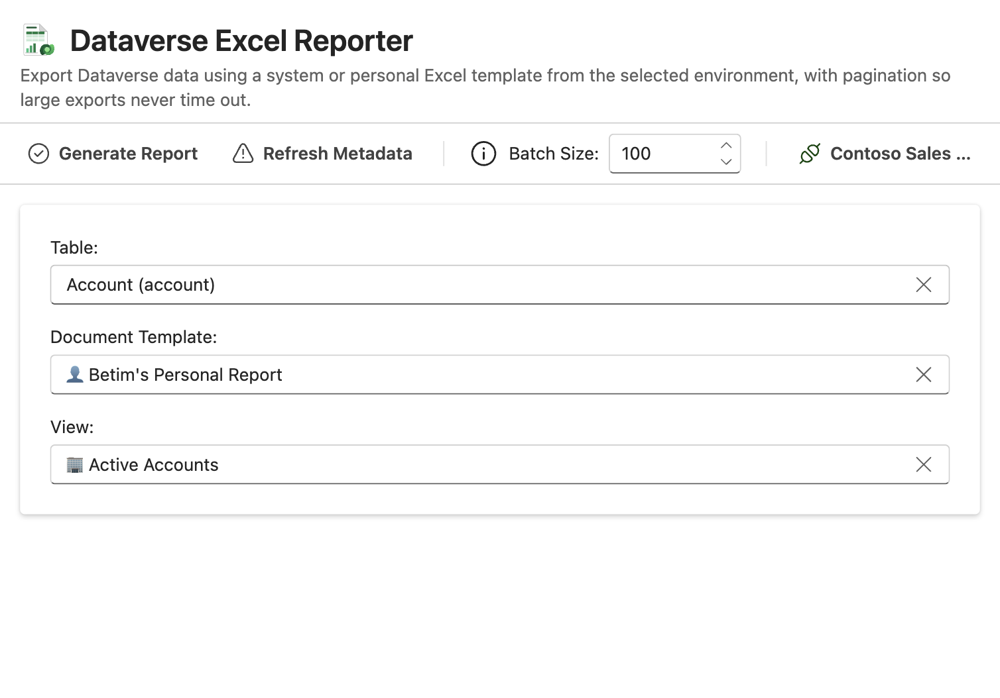
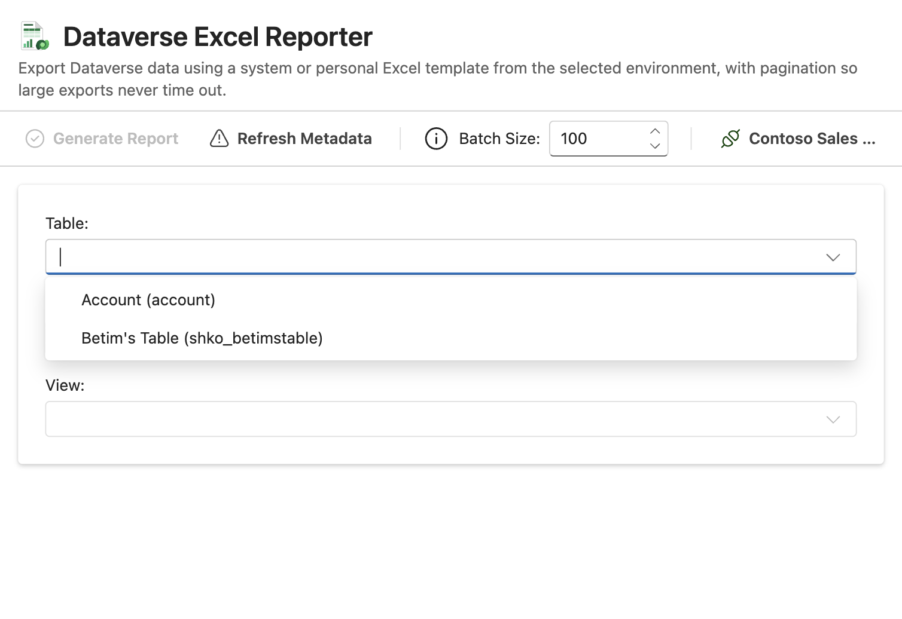
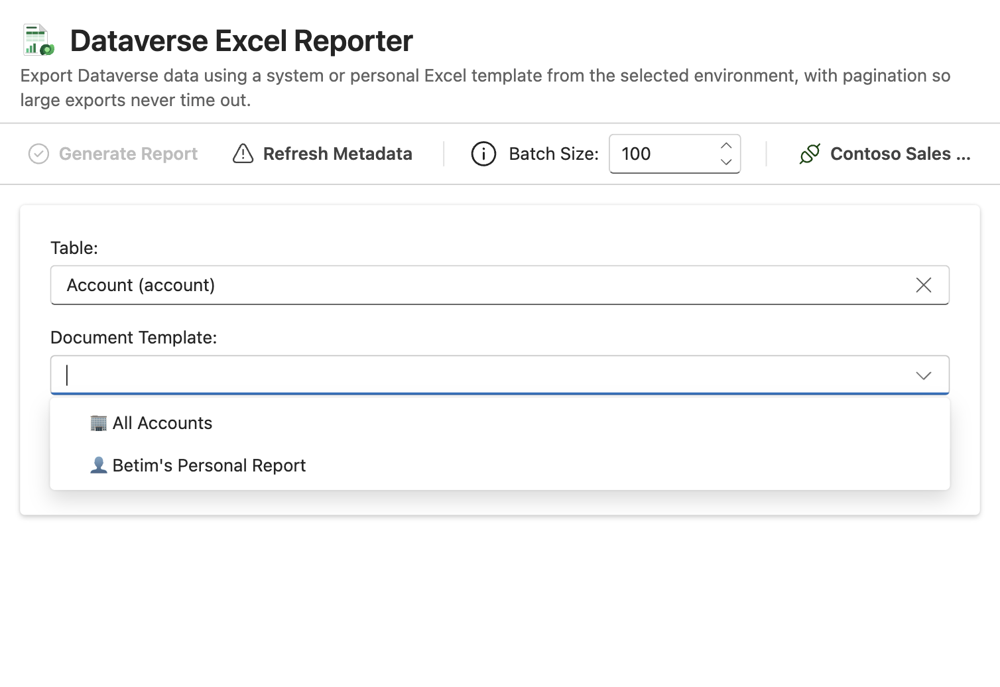
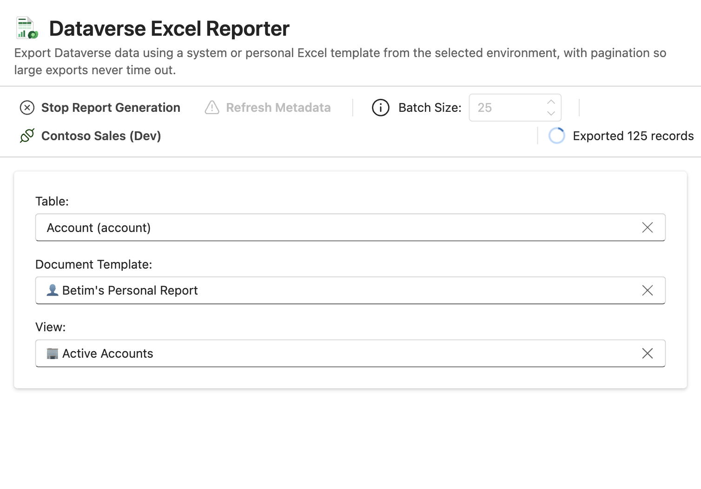
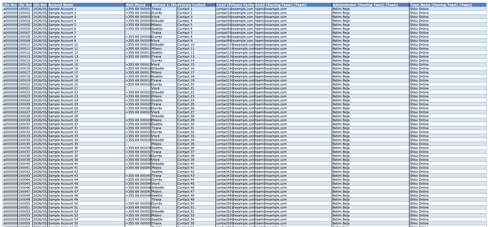
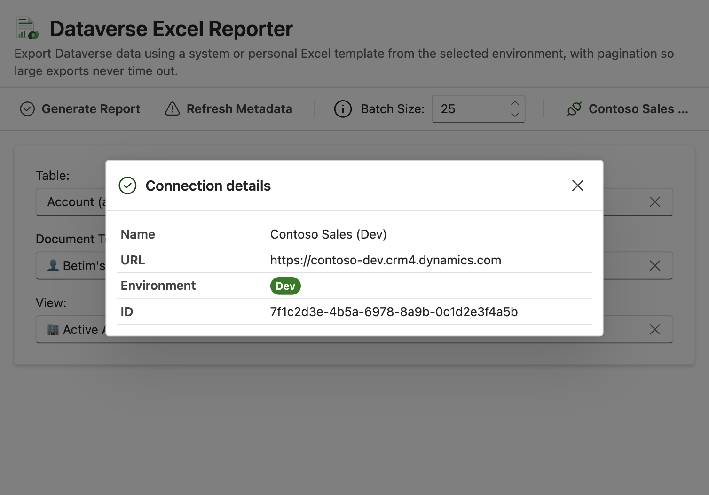

> # Copyright Notice
>
> Copyright 2026 Shko Online LLC <sales@shko.online>
> 
> Licensed under the Apache License, Version 2.0 (the "License");
> you may not use this file except in compliance with the License.
> You may obtain a copy of the License at
> 
>     http://www.apache.org/licenses/LICENSE-2.0
> 
> Unless required by applicable law or agreed to in writing, software
> distributed under the License is distributed on an "AS IS" BASIS,
> WITHOUT WARRANTIES OR CONDITIONS OF ANY KIND, either express or implied.
> See the License for the specific language governing permissions and
> limitations under the License.

# Dataverse Excel Reporter

A Power Platform ToolBox tool that exports Dataverse data using a system or personal Excel template from the selected environment. Records are retrieved page by page, so large exports don't time out the way they can when generating the report from the Dataverse UI.

It is the Power Platform ToolBox version of the [Dataverse Excel Reporter for XrmToolBox](https://github.com/Shko-Online/DataverseExcelReporter).



## What this tool does

- Lists the Excel document templates of the environment, both system (🏢) and personal (👤)
- Lists the system and personal views of each table that has a template
- Runs the selected view and writes all of its records into the template's data table
- Retrieves the records in batches (1 - 5,000 per request) using FetchXML paging, so exports of any size complete
- Fills columns from related tables configured in the template
- Keeps the rest of the template as it is (formatting, data validation, other sheets); formulas recalculate and pivot tables refresh when the file is opened
- Lets you stop a running export at any time
- Saves the report as `Report_<Table>_<yyyyMMdd_HHmmss>.xlsx`

## How to use it

### 1. Pick the table

Once connected, the tool loads the Excel templates of the environment and the views of their tables. The **Table** list only contains tables that have at least one Excel template. Every list can be searched by typing in it.



### 2. Pick the template and the view

Choose the **Document Template** that defines the report layout, and the **View** that decides which records are exported (its filters and sort order are applied; the template decides the columns). System items are marked with 🏢, personal ones with 👤.



### 3. Generate the report

Optionally change the **Batch Size** (records per request, 100 by default), then click **Generate Report**. The toolbar shows how many records have been exported so far, and **Stop Report Generation** cancels the export. When it completes, choose where to save the file.



### 4. Open the report

The records are written into the template's table, which grows to fit all of them. Formulas are recalculated and pivot tables are refreshed when the workbook is opened in Excel, so anything built on the table reflects the exported data.



### Connection details

The active connection is shown at the end of the toolbar. Click it to see the connection name, URL, environment type and ID.



## Good to know

- **Batch size**: larger batches mean fewer requests and a faster export; lower it if requests time out on tables with many columns or related columns.
- **Template layout**: the data goes into the Excel table named `Table1`, which is how Dataverse creates Excel templates. Templates without it can't be used.
- **Value formats**: numbers and currency are written as numbers, dates and times as Excel dates (in UTC, `yyyy/mm/dd hh:mm:ss`), and choices, yes/no and lookup columns as their display text.
- **Refresh Metadata** reloads the templates and views, for example after creating a new template in Dataverse.

## Development

```bash
npm install          # install dependencies
npm run dev          # start the development server
npm run build        # type-check and build the tool into dist/
npm test             # run the unit tests
npm run storybook    # run the tool against mock Dataverse data
```

The Storybook story runs the full tool with mock templates, views and 237 sample accounts, so every step above can be tried without a Dataverse environment.

## License

Apache-2.0
